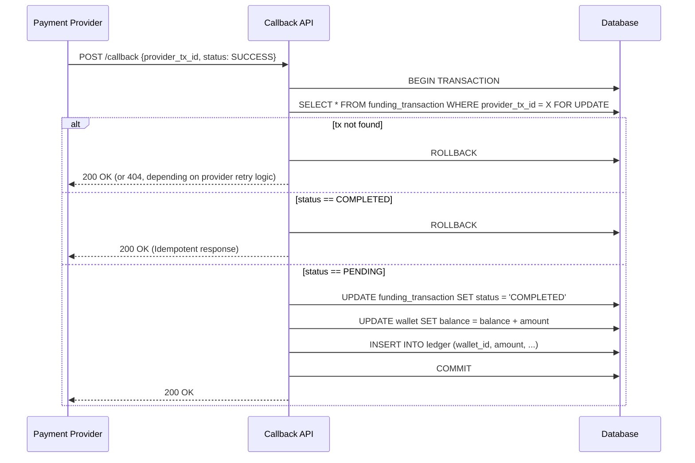

# Part B - Hands-on: exactly-once crediting

## 1. Schema Design

To ensure exactly-once crediting and maintain an accurate audit trail, we need three core tables:

```sql
CREATE TABLE wallet (
    id UUID PRIMARY KEY,
    user_id UUID NOT NULL,
    balance DECIMAL(19, 4) NOT NULL DEFAULT 0,
    currency VARCHAR(3) NOT NULL,
    updated_at TIMESTAMP NOT NULL DEFAULT NOW()
);

CREATE TABLE funding_transaction (
    id UUID PRIMARY KEY,
    provider_tx_id VARCHAR(255) UNIQUE NOT NULL, -- Used for idempotency
    wallet_id UUID NOT NULL REFERENCES wallet(id),
    amount DECIMAL(19, 4) NOT NULL,
    currency VARCHAR(3) NOT NULL,
    status VARCHAR(20) NOT NULL, -- 'PENDING', 'COMPLETED', 'FAILED'
    created_at TIMESTAMP NOT NULL DEFAULT NOW(),
    updated_at TIMESTAMP NOT NULL DEFAULT NOW()
);

CREATE TABLE ledger (
    id UUID PRIMARY KEY,
    wallet_id UUID NOT NULL REFERENCES wallet(id),
    funding_tx_id UUID NOT NULL REFERENCES funding_transaction(id),
    amount DECIMAL(19, 4) NOT NULL,
    type VARCHAR(20) NOT NULL, -- 'DEPOSIT', 'WITHDRAWAL'
    created_at TIMESTAMP NOT NULL DEFAULT NOW()
);
```

## 2. Sequence Diagram



## 3. Pseudo-code for Callback Handler

```python
def handle_payment_callback(payload):
    provider_tx_id = payload.get('transaction_id')
    
    # Start a database transaction
    with db.transaction() as tx:
        # 1. Acquire an exclusive row-level lock on the transaction.
        # This prevents concurrent callbacks for the same transaction from processing simultaneously.
        funding_tx = tx.execute(
            "SELECT * FROM funding_transaction WHERE provider_tx_id = ? FOR UPDATE", 
            provider_tx_id
        )
        
        if not funding_tx:
            # Unknown transaction. We can log and return 404 or 200 depending on provider docs.
            return HttpResponse(status=200)
            
        # 2. Idempotency Check
        if funding_tx.status == 'COMPLETED':
            # This is a duplicate or delayed callback. 
            # It has already been processed, so we just acknowledge it.
            return HttpResponse(status=200)
            
        if funding_tx.status == 'FAILED':
            # Handle accordingly, perhaps log an alert.
            return HttpResponse(status=200)
            
        # 3. Process the successful payment
        if payload.status == 'SUCCESS':
            # Update transaction status
            tx.execute("UPDATE funding_transaction SET status = 'COMPLETED', updated_at = NOW() WHERE id = ?", funding_tx.id)
            
            # Credit the wallet
            tx.execute("UPDATE wallet SET balance = balance + ?, updated_at = NOW() WHERE id = ?", [funding_tx.amount, funding_tx.wallet_id])
            
            # Append to append-only ledger for audit trail
            tx.execute("INSERT INTO ledger (wallet_id, funding_tx_id, amount, type) VALUES (?, ?, ?, 'DEPOSIT')", 
                       [funding_tx.wallet_id, funding_tx.id, funding_tx.amount])
            
            # Transaction commits automatically here
            return HttpResponse(status=200)
```

## 4. Brief Answers

**What happens if the process crashes after commit but before the provider gets a 200?**
The database transaction has already been durably committed, meaning the wallet is credited and the status is `COMPLETED`. Since the provider didn't receive the 200 OK, it will aggressively retry the callback. On the next attempt, the handler will fetch the row (with `FOR UPDATE`), see that `status == 'COMPLETED'`, execute the idempotency block, and immediately return a 200 OK without altering the balance again.

**How do you detect residual drift in production, and what runs when drift is found?**
- **Detection**: A scheduled CRON job (e.g., every hour) runs a reconciliation check: it compares the current `wallet.balance` against the arithmetic sum of all historical `ledger` entries (`SELECT SUM(amount) FROM ledger WHERE wallet_id = X`).
- **Response**: If `wallet.balance != SUM(ledger.amount)` is detected, the system immediately:
  1. Fires a high-severity alert to the on-call engineer.
  2. Automatically places a temporary freeze on the affected wallet(s) to prevent the user from withdrawing illegitimate funds while the discrepancy is investigated manually.
