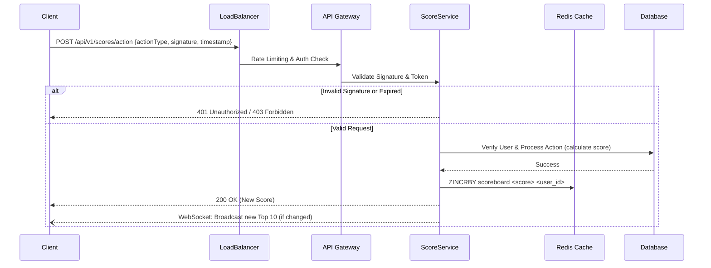

# Problem 6: Score Board API Architecture

## 1. Overview
The **Score Board API** is responsible for managing user scores, processing score-increasing actions, and providing the Top 10 leaderboard to the frontend in real-time. Since score manipulation is a high-risk activity, the system incorporates strict validation and anti-fraud measures.

## 2. Architecture Diagram



## 3. Security & Anti-Fraud Measures

To prevent malicious users from artificially increasing their scores:

1. **Authentication:** All requests must include a valid JWT token.
2. **Request Signing:** The payload must be signed using a secret key (HMAC-SHA256) stored securely on both the client and server. The signature includes a `timestamp` and a `nonce` to prevent **replay attacks**. Requests older than a few minutes are rejected.
3. **Server-Side Validation:** The client does NOT send the *score amount*. The client only sends the *action performed*. The server determines how many points that action is worth.
4. **Rate Limiting:** Implement strict IP-based and User-based rate limiting via API Gateway/Redis to prevent spamming the action endpoint.

## 4. API Endpoints

### `GET /api/v1/scores/top`
- **Description:** Returns the top 10 users with the highest scores.
- **Response:**
  ```json
  {
    "success": true,
    "data": [
      { "userId": "123", "username": "player1", "score": 9500 },
      ...
    ]
  }
  ```
- **Performance:** Served directly from a Redis Sorted Set (`ZREVRANGE scoreboard 0 9 WITHSCORES`) for O(1) read latency.

### `POST /api/v1/scores/action`
- **Description:** Dispatches an action to increase the user's score.
- **Headers:** `Authorization: Bearer <token>`, `X-Signature: <hmac>`, `X-Timestamp: <time>`
- **Request Body:**
  ```json
  {
    "actionType": "COMPLETED_LEVEL_1"
  }
  ```
- **Response:**
  ```json
  {
    "success": true,
    "newScore": 9600
  }
  ```

## 5. Execution Flow

1. **Client Action:** The user completes an action on the website.
2. **Signing:** The client generates a timestamp and signs the payload `{actionType}`.
3. **Dispatch:** The client sends the POST request to the API.
4. **Validation:** The server verifies the JWT, checks the timestamp to prevent replay, and verifies the HMAC signature.
5. **Processing:** The server looks up the points mapping for `COMPLETED_LEVEL_1` (e.g., +100 points).
6. **Persistence:** The server updates the persistent Database and increments the user's score in the Redis Sorted Set (`ZINCRBY`).
7. **Broadcast:** If the user enters the Top 10 or shifts rankings, a WebSocket event is broadcasted to all connected clients to update their scoreboards in real-time.
